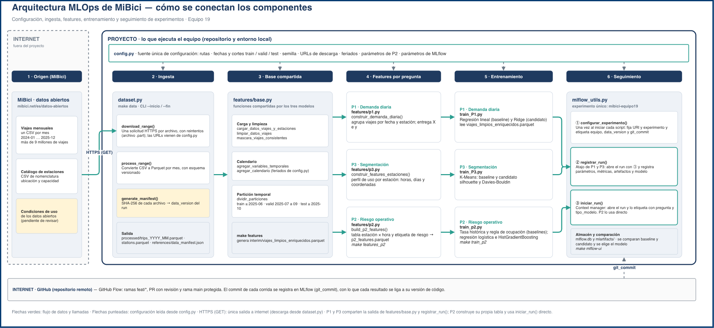

# TC5061 Proyecto Equipo 19: MiBici

<a target="_blank" href="https://cookiecutter-data-science.drivendata.org/">
    
</a>

## Propósito

Propuesta y base reproducible de Machine Learning para el sistema de bicicleta pública
[MiBici](https://www.mibici.net/) de Guadalajara. El repositorio contiene la ingesta
versionada de millones de viajes, el módulo de feature engineering y un experimento base
registrado en MLflow Tracking que valida la viabilidad técnica de la propuesta.

## Preguntas

| | Pregunta | Tarea |
|---|---|---|
| **P1** | ¿Cuántos viajes se iniciarán en una estación o zona en un periodo futuro? | Regresión |
| **P2** | ¿Una estación estará en riesgo de quedarse sin bicicletas o sin anclajes disponibles en un periodo futuro? | Clasificación |
| **P3** | ¿Qué grupos de estaciones comparten patrones de uso y dónde se ubican en la ciudad? | Clustering |

El ML Canvas y el diagrama de arquitectura están en [`references/`](references/).

## Datos

- **Fuente:** [Datos abiertos de MiBici](https://www.mibici.net/es/datos-abiertos/). Los enlaces
  exactos de cada archivo están en `tc5061_proyecto_equipo19/config.py` (`URLS_VIAJES`,
  `URL_ESTACIONES`).
- **Rango:** enero 2024 a diciembre 2025 (24 meses completos, dos ciclos anuales para
  capturar la estacionalidad).
- **Tamaño obtenido:** 9,177,953 viajes y 484 estaciones en la nomenclatura `nomenclatura_2026_09.csv`.
- **Variables usadas:** `trip_id`, `start_time`, `end_time`, `origin_station_id`,
  `destination_station_id` y, del catálogo, `station_id`, `station_name`, `latitude`,
  `longitude`, `capacity`. Detalle en [`references/data_dictionary.md`](references/data_dictionary.md).
- **Datos personales:** `Usuario_Id`, `Genero` y `Año_de_nacimiento` se descartan en la ingesta y
  nunca llegan a los Parquet. Los datos crudos y procesados no se suben a Git.
- **Partición temporal** (definida en `config.py`): entrenamiento 2024-01 a 2025-06, validación
  2025-07 a 2025-09 y prueba 2025-10 a 2025-12. Las variables solo usan información anterior al
  momento de la predicción y las estadísticas se calculan solo con el periodo de entrenamiento.
- **Versionado:** `references/data_manifest.json` guarda, por archivo, el número de registros y el
  hash SHA-256 del CSV original y del Parquet. Su campo `data_version` es un hash corto de todos
  los Parquet; cada run de MLflow lo registra como parámetro y etiqueta, y adjunta el manifiesto
  como artefacto. Si cambian los datos, cambia `data_version` y el cambio queda en el historial de Git.

## Arquitectura



El diagrama editable está en `docs/arquitectura/arquitectura_mibici.drawio` (se abre en app.diagrams.net).

## Estructura de carpetas

```
├── Makefile           <- Comandos: make data, make features, make features_p2, make train_p2, make mlflow-ui
├── README.md
├── data               <- No se versiona en Git
│   ├── raw            <- CSV originales descargados de MiBici
│   ├── interim        <- Viajes limpios y enriquecidos
│   └── processed      <- Parquet normalizados (trips_AAAA_MM.parquet, stations.parquet)
├── docs               <- Proyecto de mkdocs
├── models             <- Modelos serializados (no se versionan)
├── notebooks          <- Notebooks de exploración (número-iniciales-descripción)
├── pyproject.toml     <- Metadatos del paquete y configuración de ruff
├── references         <- ML Canvas, diagrama de arquitectura, diccionario y manifiesto de datos
├── reports
│   └── figures        <- Figuras generadas por el experimento
├── requirements.txt   <- Dependencias con versiones fijadas
└── tc5061_proyecto_equipo19
    ├── config.py      <- Rutas, fechas, particiones, semillas, URLs y configuración de MLflow
    ├── dataset.py     <- Ingesta: descarga, normalización, Parquet y manifiesto
    ├── features/      <- Paquete de feature engineering reutilizable
        ├── base.py    <- Carga, limpieza, calendario y partición temporal (compartido)
        ├── p1.py      <- Demanda diaria por estación (P1)
        ├── p2.py      <- Variables y etiqueta de riesgo (P2)
        └── p3.py      <- Perfil de uso por estación (P3)
    ├── plots.py
    └── modeling
        ├── mlflow_utils.py <- Parámetros, etiquetas y artefactos comunes de cada run
        ├── train_p2.py     <- Baselines y candidatos de P2 registrados en MLflow
        ├── train.py
        └── predict.py
```

## Instalación

Requiere Python 3.14.

```bash
git clone https://github.com/A01797947/TC5061-Proyecto-Equipo19.git
cd TC5061-Proyecto-Equipo19
python3.14 -m venv .venv
source .venv/bin/activate          # Windows: .venv\Scripts\activate
python -m pip install -r requirements.txt
```

## Ingesta de datos

Descarga los 24 meses y la nomenclatura, normaliza columnas, codificación y fechas, guarda Parquet
y regenera el manifiesto. Los archivos ya descargados no se vuelven a bajar.

```bash
make data
# equivalente a:
python -m tc5061_proyecto_equipo19.dataset
# por etapas:
python -m tc5061_proyecto_equipo19.dataset descargar
python -m tc5061_proyecto_equipo19.dataset procesar
```

Al terminar, compara `references/data_manifest.json` con el de `main`: si `data_version` coincide,
tienes exactamente los mismos datos que el resto del equipo.

## Experimento en MLflow

Todos los runs van al experimento `mibici-equipo19`, guardado en `mlflow.db` (SQLite) con
artefactos en `mlartifacts/`. Para usar un servidor de MLflow compartido, define
`MLFLOW_TRACKING_URI` en un archivo `.env`.

`tc5061_proyecto_equipo19/modeling/mlflow_utils.py` da a cada run lo que necesita para ser
reproducible:

- **Parámetros:** rango de fechas, cortes de entrenamiento, validación y prueba, `data_version`,
  versión del esquema, número de meses y viajes y semilla, más los del modelo.
- **Etiquetas:** `equipo`, `pregunta`, `tipo_modelo` (baseline o candidato), `git_commit`,
  `git_branch`, `git_dirty` y `data_version`.
- **Artefactos:** el manifiesto de datos, al que cada run agrega sus figuras.

Ejecuta los runs con el árbol de trabajo limpio (sin cambios sin commit) para que `git_commit`
identifique exactamente el código usado; `git_dirty=True` indica lo contrario.

### Capturas de evidencia

```bash
# Servidor requerido para Model Registry (ejecutar desde la raíz):
mlflow server --backend-store-uri sqlite:///mlflow.db --artifacts-destination ./mlartifacts --host 127.0.0.1 --port 5000
```

Abre http://127.0.0.1:5000 y toma estas capturas:

1. **Lista de runs:** experimento `mibici-equipo19` en la pestaña *Runs*, con las columnas de
   métricas y la etiqueta `pregunta` visibles.
2. **Detalle de un run:** las secciones *Parameters*, *Metrics* y *Tags* de un run.
3. **Artefacto:** la pestaña *Artifacts* de un run con una figura abierta.
4. **Comparación:** selecciona dos o más runs y pulsa *Compare*; captura la tabla de parámetros y
   métricas.

## P2. Riesgo de estación sin bicicletas o sin anclajes

Clasificación por estación y hora: ¿la estación quedará vacía o llena en las próximas tres horas? La aproximación del riesgo, el pipeline, los modelos, las métricas y lo que se registra en MLflow están en [`references/p2_riesgo_estaciones.md`](references/p2_riesgo_estaciones.md).

```bash
make features_p2   # python -m tc5061_proyecto_equipo19.features.p2: tabla de variables y etiqueta
make train_p2      # python -m tc5061_proyecto_equipo19.modeling.train_p2: baselines y candidatos en MLflow
```

## Equipo

| Integrante | Rol |
|---|---|
| José Llashag Huaman | Por definir |
| Ismael Ortiz Díaz | Por definir |
| José Martín Ramos Requena | Por definir |
| Denisse Martínez Ruíz | Por definir |

## Flujo de trabajo con Git y GitHub

Seguimos [GitHub Flow](https://docs.github.com/en/get-started/using-github/github-flow): un flujo ligero donde `main` siempre está estable y todo cambio nace en una rama corta y entra por Pull Request.

### Principios

1. **`main` es la única rama permanente** y siempre contiene código que funciona.
2. **Nadie hace push directo a `main`.** Todo cambio entra mediante Pull Request.
3. **Trabajamos en ramas en el mismo repositorio, sin forks.** Los integrantes son colaboradores con permiso de escritura.
4. **Toda rama sale de `main` actualizada** y vive poco tiempo.
5. **Cada Pull Request lo revisa otra persona** antes de integrarse.
6. **Los Pull Requests son pequeños y enfocados** en un solo cambio.

### Protección de la rama `main`

La rama `main` está protegida (Settings → Branches → Branch protection rules) con estas reglas:

| Regla | Efecto |
|---|---|
| Require a pull request before merging | No se puede hacer push directo |
| Required approvals: 1 | Alguien distinto al autor debe aprobar |
| Dismiss stale pull request approvals | Un commit nuevo invalida aprobaciones previas |
| Require conversation resolution | Los comentarios deben resolverse antes del merge |
| Block force pushes y deletions | El historial de `main` no se reescribe ni se borra |
| Do not allow bypassing the above settings | Las reglas también aplican al dueño del repo y a los administradores: nadie puede hacer push directo a `main` ni hacer merge sin la aprobación de otra persona |

### Convención de nombres de ramas

Formato: `tipo/descripcion-corta`, en minúsculas y separando palabras con guiones.

| Tipo | Uso | Ejemplo |
|---|---|---|
| `feat` | Funcionalidad nueva | `feat/ingesta-parquet` |
| `fix` | Corrección de un error | `fix/encoding-2024` |
| `exp` | Modelos y experimentos | `exp/p1-baseline-regresion` |
| `docs` | Documentación | `docs/readme-flujo-git` |
| `chore` | Mantenimiento del repositorio | `chore/ampliar-gitignore` |

### Convención de mensajes de commit

Usamos [Conventional Commits](https://www.conventionalcommits.org/):

```
tipo(alcance): descripción en imperativo y minúsculas
```

- **Tipos:** `feat`, `fix`, `docs`, `refactor`, `test`, `chore`.
- **Alcances:** `dataset`, `features`, `p1`, `p2`, `p3`, `mlflow`, `repo`, `docs`.
- La descripción va en imperativo, sin punto final y de preferencia con menos de 72 caracteres.

Ejemplos:

```
feat(dataset): normalizar nombres de columnas entre años
fix(features): evitar fuga de información en lags
feat(p3): agregar mapa de estaciones por cluster
chore(repo): ampliar gitignore con mlruns y mlartifacts
docs(readme): documentar comandos de ingesta
```

### Paso a paso de un cambio

**Paso 0. Configuración inicial (una sola vez)**

```bash
git clone https://github.com/A01797947/TC5061-Proyecto-Equipo19.git
cd TC5061-Proyecto-Equipo19
git config user.name "Tu Nombre"
git config user.email "tu-correo@ejemplo.com"
```

**Paso 1. Actualizar `main` local**

```bash
git checkout main
git pull origin main
```

**Paso 2. Crear la rama de trabajo**

```bash
git checkout -b feat/ingesta-parquet main
```

**Paso 3. Trabajar y hacer commits pequeños y frecuentes**

```bash
git status
git add tc5061_proyecto_equipo19/dataset.py
git commit -m "feat(dataset): descargar meses y nomenclatura de estaciones"
```

Agrega archivos concretos con `git add <archivo>` y evita `git add .`, para no subir datos, `.env`, `mlruns/` ni modelos por accidente.

**Paso 4. Subir la rama**

```bash
git push -u origin feat/ingesta-parquet
```

Las ramas de trabajo no están protegidas, así que cada quien puede hacer push libremente a la suya.

**Paso 5. Mantener la rama al día**

Si `main` avanzó mientras trabajabas:

```bash
git fetch origin
git merge origin/main
```

Si hay conflictos, resuélvelos en tu rama (ver *Resolver conflictos*), haz commit y vuelve a hacer push.

**Paso 6. Abrir el Pull Request**

En GitHub: Compare & pull request, con base `main` y compare tu rama. Usa:

- **Título:** el mismo formato de Conventional Commits, por ejemplo `feat(dataset): ingesta reproducible a Parquet`.
- **Descripción:** qué cambia, por qué y cómo probarlo.
- **Reviewer:** el siguiente en la rotación (ver *Rotación de revisores*).
- Marca el PR como Draft si aún no está listo.

**Paso 7. Revisión**

El revisor lee los cambios y comenta o aprueba (ver *Rotación de revisores* y *Qué revisa el revisor*). El autor responde y corrige con nuevos commits en la misma rama. Al hacer push, el PR se actualiza solo.

**Paso 8. Merge**

Con la aprobación y las conversaciones resueltas, se usa **Squash and merge**, que deja un commit limpio en `main` con el título del PR. Después se elimina la rama remota (botón Delete branch).

**Paso 9. Limpiar localmente**

```bash
git checkout main
git pull origin main
git branch -d feat/ingesta-parquet
```

### Rotación de revisores

Cada integrante hace al menos un Pull Request propio y al menos una revisión a otro integrante. Para repartir las revisiones usamos una rotación circular:

```
José Llashag Huaman → Ismael Ortiz Díaz → José Martín Ramos Requena → Denisse Martínez Ruíz → José Llashag Huaman
```

Quien abre un PR lo asigna a la siguiente persona en la rotación. Si el revisor asignado no está disponible, cualquier otro integrante puede revisarlo.


### Qué revisa el revisor

- [ ] El código corre y hace lo que dice el PR.
- [ ] No hay datos de MiBici, credenciales, `.env`, `mlruns/` ni modelos serializados en el commit.
- [ ] Las rutas, fechas y semillas vienen de `config.py` y no están escritas a mano.
- [ ] Las variables no usan información posterior al momento de la predicción.
- [ ] Las funciones nuevas tienen docstring que explica qué hacen y por qué son pertinentes.
- [ ] Los nombres de la rama y los commits siguen la convención.
- [ ] El PR cubre una sola cosa y es fácil de leer.

Cada revisión termina en una de tres acciones: Approve, Comment o Request changes.

### Resolver conflictos

Un conflicto aparece cuando dos ramas modifican las mismas líneas. Se resuelve en la rama propia, nunca en `main`:

```bash
git fetch origin
git merge origin/main
# Git marca los archivos en conflicto con <<<<<<<, ======= y >>>>>>>
# Edita cada archivo, deja la versión correcta y quita los marcadores
git add <archivo-resuelto>
git commit
git push
```

VS Code (con la extensión GitLens) muestra los conflictos y permite elegir entre los cambios entrantes, los actuales o ambos. Si hay duda sobre cuál versión conservar, hablen con el autor del otro cambio antes de decidir.

### Buenas prácticas

- Haz commits pequeños con un propósito claro.
- Abre el PR temprano, como Draft, si quieres retroalimentación a medio camino.
- Responde las revisiones a tiempo para no bloquear al equipo.
- No reescribas el historial de una rama que ya se compartió.
- Si algo salió mal en `main`, se corrige con un nuevo PR (por ejemplo `fix/...` o `git revert`), nunca con force push.
- Los modelos y las figuras generadas se suben solo cuando el equipo lo decide, y nunca los datos crudos.


---

## Entrega MLOps: Partes A, B y C (MLflow Projects 3.x)

### A. Proyecto reproducible y ejecución desde un clon limpio

**Entorno:** Python 3.14 y dependencias del archivo `requirements.txt` con versiones
fijadas, referenciado en `python_env.yaml` y declarado en `MLproject`.
En Windows PowerShell, desde la raíz del repositorio:

```powershell
py -3.14 -m venv .venv
.\.venv\Scripts\Activate.ps1
python -m pip install -r requirements.txt
```

**Servidor local, consola 1:**

```powershell
mlflow server --backend-store-uri sqlite:///mlflow.db --artifacts-destination ./mlartifacts --host 127.0.0.1 --port 5000
```

**Consola 2:**

```powershell
.\.venv\Scripts\Activate.ps1
$env:MLFLOW_TRACKING_URI = "http://127.0.0.1:5000"
```

Usar `mlflow run` en todos los experimentos entregables (desde la raíz).
`--env-manager local` utiliza el entorno de Python ya activado; si se desea que
MLflow cree un entorno virtual, omitir esa opción y asegurarse de disponer
exactamente de la versión de Python de `python_env.yaml`.

La ingesta vuelve a descargar los CSV crudos ausentes y produce los 24 Parquet
más `stations.parquet` y `references/data_manifest.json`:

```powershell
mlflow run . -e ingest --env-manager local
```

Reproducción mínima de un modelo por pregunta:

```powershell
mlflow run . -e train --env-manager local -P question=p1 -P model=linear
mlflow run . -e train --env-manager local -P question=p2 -P model=hgb
mlflow run . -e train --env-manager local -P question=p3 -P model=kmeans
```

`config.py` centraliza rutas, meses, particiones temporales, semillas y valores
por defecto. Los parámetros adicionales del entry point `train` solo anulan
valores de `config.py` cuando se indican explícitamente.

**Nota sobre runs:** MLflow Projects crea una corrida de orquestación; los
entrenamientos registrados por los scripts quedan en `mibici-equipo19` y enlazan
su corrida de orquestación mediante el tag `mlflow_project_run_id`. Esto evita
que la ejecución caiga en el experimento `Default` y permite agrupar búsquedas.

### B. Doce versiones y nested runs

**P1 (baseline + tres versiones Ridge como corridas hijas):**

```powershell
mlflow run . -e train --env-manager local -P question=p1 -P model=linear
mlflow run . -e search --env-manager local -P question=p1
```

El segundo comando crea `P1-search-ridge` como corrida padre y tres hijas con
`alpha=0.1, 1.0, 10.0`, valores centralizados en `config.py`. Las particiones
se preparan una sola vez en la búsqueda para ahorrar memoria y tiempo. **No
cambia el conjunto temporal entre versiones.**

**P2 (baseline + tres candidatas):**

```powershell
mlflow run . -e train --env-manager local -P question=p2 -P model=tasa_historica
mlflow run . -e train --env-manager local -P question=p2 -P model=logreg
mlflow run . -e train --env-manager local -P question=p2 -P model=hgb
mlflow run . -e train --env-manager local -P question=p2 -P model=hgb -P learning_rate=0.05 -P max_iter=250
```

La tasa histórica es **baseline no entrenable** y no genera modelo serializado;
no debe promoverse a Registry. Las tres corridas de `logreg` y `hgb` sí guardan
modelos. P2 utiliza la misma partición de 2024–2025 y prioriza precisión en
`top_k` para ordenar la atención del personal operativo; también reporta
average precision, recall, F1, F2, curva PR, matriz de confusión y calibración.

**P3 (baseline y tres variantes de K-Means):**

```powershell
mlflow run . -e train --env-manager local -P question=p3 -P model=kmeans -P model_type=baseline -P n_clusters=3
mlflow run . -e train --env-manager local -P question=p3 -P model=kmeans -P n_clusters=3
mlflow run . -e train --env-manager local -P question=p3 -P model=kmeans -P n_clusters=4
mlflow run . -e train --env-manager local -P question=p3 -P model=kmeans -P n_clusters=5
```

**Cambio metodológico relevante en P3:** la versión anterior construía grupos
sobre los 24 meses completos. La nueva implementación entrena **únicamente**
con los perfiles de enero 2024–junio 2025 y compara la estabilidad de asignación
en validación (julio–septiembre 2025) y prueba (octubre–diciembre 2025), sin
reajustar el modelo. Los conteos se convierten a **viajes por día** para que
intervalos de diferente duración sean comparables. Además de silhouette en
train se guardan `valid_silhouette`, `test_silhouette` y el índice de Rand
ajustado entre periodos (`valid_ari_vs_train`, `test_ari_vs_train`). Por este
cambio **no se deben comparar directamente** los resultados de P3 con corridas
antiguas de 24 meses; se requiere usar los nuevos baselines y justificar la
modificación en el informe.

**Estructura de artefactos:**

- `data/`: manifiesto con hashes y versión completa de datos.
- `config/`: `run_config.json` con el modelo y sus parámetros.
- `plots/`: gráficos de evaluación (P1, P2, P3).
- `evaluation/`: métricas y perfiles/grupos de estaciones.
- Modelo MLflow 3 vinculado a la corrida por el tag `logged_model_uri`;
  incluye firma y `input_example`.

El log de entrada de MLflow usa **muestras de características** sin campos
personales; la versión completa se acredita por el manifiesto. Los Parquet y
CSV no se añaden al Git ni se publican como artefactos íntegros.

### B. Comparar antes de seleccionar

```powershell
python -m tc5061_proyecto_equipo19.modeling.compare_models
```

El script compara **solo corridas terminadas con el mismo `data_version`** y
métricas de validación: P1 `valid_mae` (menor), P2 `valid_precision_at_10`
(mayor; `TOP_K` se configura), P3 `valid_silhouette` (mayor). Muestra valores
de prueba únicamente como evidencia complementaria, no para elegir hiperparámetros.
Guarda `outputs/model_comparison.json`. Complementar la elección con estabilidad
entre periodos, desempeño frente al baseline y costo del run; rellenar
[`reports/seleccion_modelos_plantilla.md`](reports/seleccion_modelos_plantilla.md)
con los resultados reales de MLflow. **Los ganadores no se eligen ni registran
sin ejecutar primero todas las versiones en el entorno local.**

### C. Registrar modelos, publicar champion y comprobar carga

Una vez justificados tres ganadores, reemplazar los ejemplos de RUN_ID por los
IDs **reales** de las corridas seleccionadas (con `logged_model_uri`). No hay
números ni IDs de modelo precargados en el Registry:

```powershell
python -m tc5061_proyecto_equipo19.modeling.register_models --question p1 --run-id RUN_ID_P1 --champion --justification "Menor MAE de validacion y mejora frente al baseline"
python -m tc5061_proyecto_equipo19.modeling.register_models --question p2 --run-id RUN_ID_P2 --champion --justification "Mayor precision at 10, buen recall y costo aceptable"
python -m tc5061_proyecto_equipo19.modeling.register_models --question p3 --run-id RUN_ID_P3 --champion --justification "Mejor silhouette de validacion y estabilidad temporal"
```

Se crean/actualizan los modelos:

- `mibici-equipo19-p1-demanda`
- `mibici-equipo19-p2-riesgo`
- `mibici-equipo19-p3-grupos`

Cada versión lleva en tags y descripción el nombre del equipo, corrida,
experimento, commit y `data_version`. **Se utilizan aliases (`champion`) en
lugar de las etapas clásicas `Production`** porque simplifican la actualización
de versiones sin cambiar la URI de consumo.

```powershell
python -m tc5061_proyecto_equipo19.modeling.verify_models
```

La verificación carga los tres modelos desde
`models:/mibici-equipo19-pN-...@champion` y comprueba que tengan firma.
Para inferencia de riesgo P2 ordenando estaciones, usar el flavor
`mlflow.sklearn.load_model(uri).predict_proba(X)[:, 1]` además de los datos de
entrada esperados; `pyfunc.predict` del clasificador devuelve clases 0/1.
