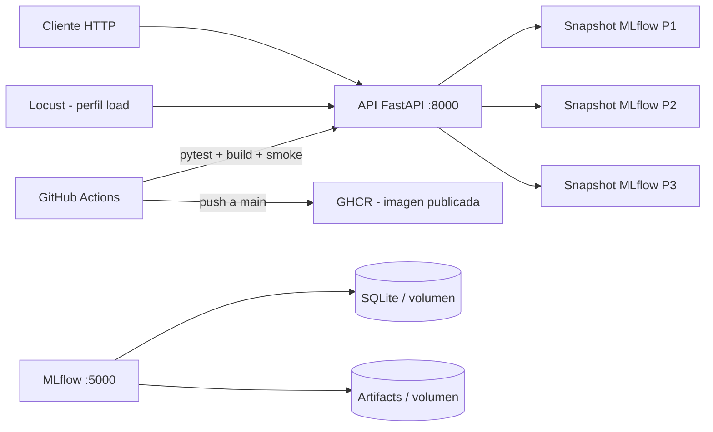

# Entregable 7 — Microservicios, CI/CD y FinOps

**Equipo 19 — Proyecto MiBici.** Documento base para el informe académico.

> Estado actualizado (18/11/2026): **Compose con Podman y smoke test P1/P2/P3 validados localmente; GitHub Actions y métricas de carga pendientes**.
> Los resultados y gráficas de carga deben provenir de Locust y del monitor de recursos,
> nunca de valores supuestos. Después de ejecutar las pruebas, adjuntar los archivos
> `*_resumen.md` y sus gráficas generadas automáticamente.

## 1. Resumen ejecutivo

El Entregable 7 operacionaliza los tres modelos P1 (regresión de demanda), P2
(clasificación de riesgo de estación) y P3 (clustering de perfiles), que se sirven
mediante una API FastAPI contenerizada. Docker Compose arranca la API y un servidor
MLflow; Locust genera tráfico HTTP mediante un perfil de Compose; GitHub Actions
prueba, compila y verifica el contenedor, y publica una imagen en GHCR únicamente
cuando una modificación llega a la rama `main`.

## 2. Arquitectura y alcance



Los modelos son snapshots del Registry con `alias=champion`, firma de entrada y
SHA-256 registrados en `deployment/model_store/manifest.json`. Se cargan al inicio
una vez, no se consultan a MLflow por solicitud. El servidor MLflow se incluye
para tracking, experimentación y uso futuro del Registry; en modo local utiliza una
base SQLite independiente. Para consultar los runs previos del equipo puede usarse
el override de Supabase, con credenciales locales privadas.

**Servicios:**

| Servicio | Contenedor | Exposición | Propósito |
|---|---|---|---|
| `api` | `Containerfile` | `127.0.0.1:8000` | Predicción P1, P2 y P3 |
| `mlflow` | `orchestration/mlflow/Containerfile` | `127.0.0.1:5000` | Tracking/UI y Registry |
| `locust` (perfil) | `locustio/locust:2.47.0` | No expone puerto | Generación de carga |

## 3. CI/CD

Archivo `.github/workflows/entregable7-cicd.yml`. Activación por `push`,
`pull_request` y `workflow_dispatch`. Etapas:

1. Instalación Python 3.14, `pip check`, `pytest -m 'not deepchecks'`.
2. Validación de SHA-256 del snapshot P1/P2/P3 y validación sintáctica de Compose.
3. Build de la imagen OCI; arranque temporal y smoke test HTTP de los tres endpoints.
4. Publicación de imagen en GHCR únicamente para `push` a `main` (continuous delivery).

La publicación en GHCR **no equivale a despliegue automático en un servidor de producción**;
no se dispone de un destino remoto ni credenciales de despliegue. Para ejecutar la imagen
publicada en un entorno se requiere un paso de despliegue adicional.

## 4. Diseño de pruebas de carga

Se mantienen los mismos ejemplos JSON que en el smoke test, con una distribución
aproximada de 50% P1, 30% P2 y 20% P3 por tareas ponderadas y espera aleatoria
entre solicitudes de 1 a 2 segundos.

| Escenario propuesto | Usuarios | Spawn/s | Duración | Ejecución |
|---|---:|---:|---:|---|
| Baja | 5 | 1 | 120 s | `python -m load_testing.benchmark --engine podman --run-id baja5 --users 5 --spawn-rate 1 --duration 120` |
| Media | 20 | 4 | 120 s | `python -m load_testing.benchmark --engine podman --run-id media20 --users 20 --spawn-rate 4 --duration 120` |
| Alta | 50 | 5 | 180 s | `python -m load_testing.benchmark --engine podman --run-id alta50 --users 50 --spawn-rate 5 --duration 180` |

Se medirán: solicitudes exitosas, tasa de error, RPS exitosos, latencia media y
percentiles p50/p95/p99 por endpoint, uso promedio de CPU y pico de RAM de API
más MLflow. El benchmark genera CSV, HTML de Locust, JSON, MD y gráficas de PNG.
Para el reporte consolidado, incluir los tres `*_resumen.md` reales.

**Pendiente de completar tras ejecución:**

| Métrica | Baja | Media | Alta |
|---|---|---|---|
| RPS de predicciones exitosas | Pendiente | Pendiente | Pendiente |
| Latencia p95 (ms) | Pendiente | Pendiente | Pendiente |
| Errores (%) | Pendiente | Pendiente | Pendiente |
| CPU API media (%) | Pendiente | Pendiente | Pendiente |
| RAM API máxima (MiB) | Pendiente | Pendiente | Pendiente |
| Costo USD/inferencia exitosa | Pendiente | Pendiente | Pendiente |

## 5. Monitoreo de recursos

Durante la misma ventana que Locust, `load_testing.benchmark` ejecuta periódicamente
`docker stats --no-stream` o `podman stats --no-stream`; guarda hora, CPU y memoria
por servicio. Comparar picos y tendencia con la evolución de RPS y latencia. Se
sugiere tomar intervalos de 5 segundos y repetir varias corridas por nivel.
En Podman sobre Windows, el consumo medido refleja los contenedores dentro de
la VM de Podman, no el consumo completo del host Windows.

## 6. FinOps — supuestos y fórmula

**Referencia auditable:** [Amazon EC2 T3](https://aws.amazon.com/ec2/instance-types/t3/),
Linux/Unix, us-east-1, instancia `t3.large`: **2 vCPU, 8 GiB RAM, USD 0.0835/h**.
La tarifa es solo un punto de referencia: comparar contra precios vigentes
antes de una cotización real.

Sea `S` el número de inferencias exitosas, `T` la duración configurada
**en segundos**, y `C` el precio horario de la instancia:

- Costo computacional del periodo (USD): `C × T / 3600`.
- Inferencias exitosas por segundo: `S / T`.
- Costo unitario estimado (USD/inferencia exitosa): `(C × T / 3600) / S`.
- Costo de VM 24/7 de 30 días, sin extras: `C × 720` = **USD 60.12**.

**Ejemplo estrictamente hipotético (no es resultado medido):** si la tasa fuera
10 inferencias exitosas/s, el costo unitario sería
`0.0835 / (10 × 3600)` ≈ **USD 0.00000232** por inferencia; no es un valor
atribuible al sistema MiBici hasta ejecutar las mediciones.

El numerador asigna el costo completo de una VM hipotética a la solución
(API + MLflow), sin prorrateo por CPU: la CPU% es señal de dimensionamiento,
no precio de consumo. Se excluyen EBS/almacenamiento, tráfico de salida,
backups, observabilidad, impuestos, cargos de servicios administrados,
créditos de CPU T3 Unlimited y licencias. La capacidad obtenida localmente no
es garantía de capacidad de la instancia AWS y debe validarse con un benchmark
real en el proveedor. Los costos unitarios bajo tráfico intermitente aumentarán
si la instancia queda encendida durante horas ociosas.

## 7. Oportunidades de optimización y decisiones

- Identificar el escenario con latencia p95 y errores aceptables antes de aumentar réplicas.
- Separar MLflow del entorno de serving si consume recursos sin aportar al request path.
- Probar diferentes tamaños/familias de máquinas al tener medidas de CPU/RAM.
- Considerar autoescalado, apagado fuera de horario o instancias comprometidas
  cuando el patrón de demanda esté documentado.
- Evitar comparaciones de ahorro sin controlar volumen, concurrencia,
  disponibilidad y SLO de respuesta.

## 8. Avance verificado y próximos resultados

El 18/11/2026 se comprobó en Windows + WSL2 + Podman: arranque de
`api` y `mlflow`; GET `/health` con versiones 1 de P1/P2/P3 y tres
predicciones HTTP correctas. Las advertencias de versiones MLflow/NumPy/Pandas/
skops registradas en los logs no impidieron la inferencia tras actualizar la
allowlist verificada de los snapshots. La corrección de `MLmodel` y el
`manifest.json` recalculado deben **formar parte del commit** para que CI use los
mismos artefactos; de lo contrario el smoke test en GitHub podría fallar.

No se dispone todavía de resultados Locust reales ni de una URL verificable de
workflow en verde. **No presentar el informe como cerrado** hasta completar los
escenarios e incorporar el resumen comparativo generado con:

```powershell
python -m load_testing.consolidate --runs baja5 media20 alta50
```

Añadir al informe final:

- **Repositorio:** [PEGAR URL pública o accesible al profesor].
- **Workflow en verde:** [PEGAR URL de ejecución exitosa de GitHub Actions].
- **Comparación de escenarios:** [`RESUMEN_COMPARATIVO.md`](RESUMEN_COMPARATIVO.md) (generar con datos reales).
- **Discusión:** explicar la curva de latencia/RPS, los errores, CPU/RAM,
  y la proyección USD/inferencia, con limitaciones de extrapolar Podman a EC2.

## 9. Evidencias y entregables esperados

- Captura de `podman compose ps` con API y MLflow saludables, y pantallas `/docs` y MLflow.
- Captura del workflow exitoso en Actions y publicación GHCR (solo en `main`).
- HTML de Locust, CSV y gráficas para baja, media y alta concurrencia.
- CSV de consumo de recursos y análisis de costo unitario generado por escenario.
- Comentarios finales contrastando tendencias y límites del estudio.

## 10. Referencias

- Docker Compose: https://docs.docker.com/compose/
- MLflow Tracking Server: https://mlflow.org/docs/latest/tracking/server/
- GitHub Actions: https://docs.github.com/en/actions/
- Locust CLI: https://docs.locust.io/en/stable/configuration.html
- Docker stats: https://docs.docker.com/reference/cli/docker/container/stats/
- Podman stats: https://docs.podman.io/en/latest/markdown/podman-stats.1.html
- AWS EC2 T3 precios: https://aws.amazon.com/ec2/instance-types/t3/
- FinOps Foundation: https://www.finops.org/wg/finops-for-ai-overview/
