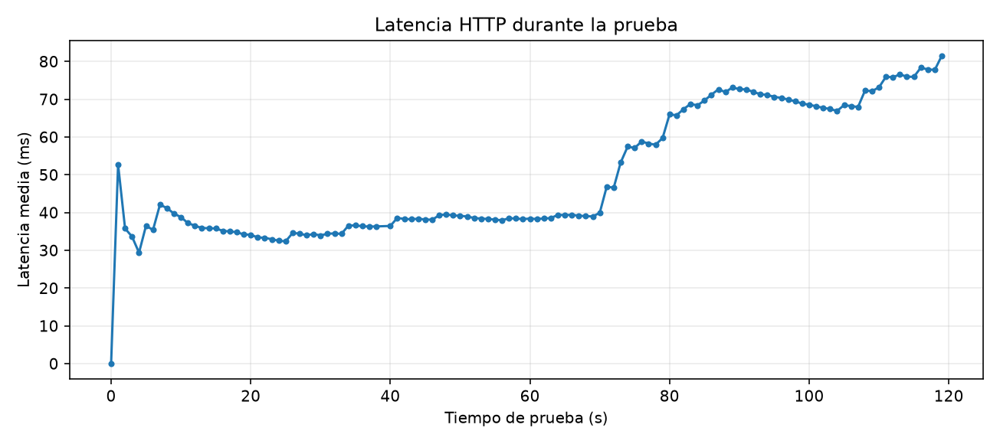
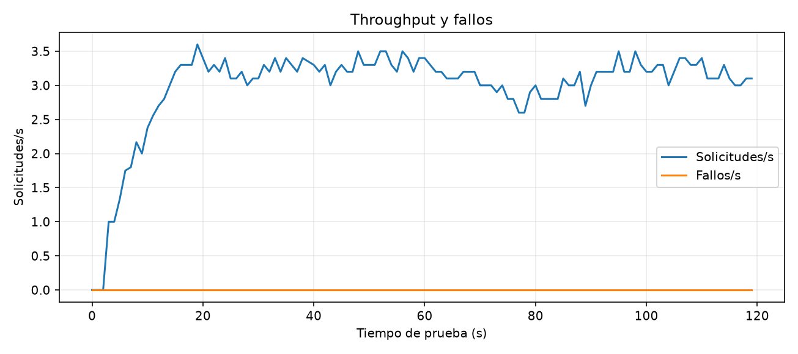
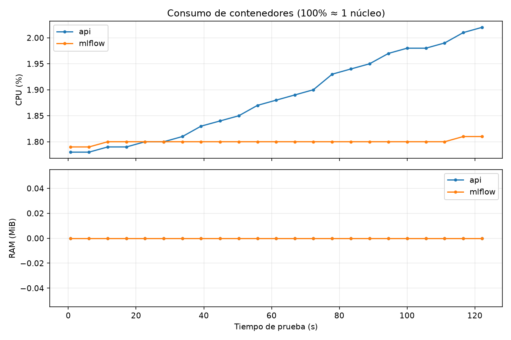
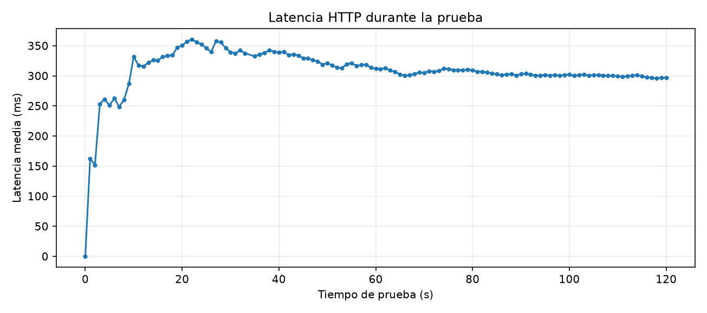
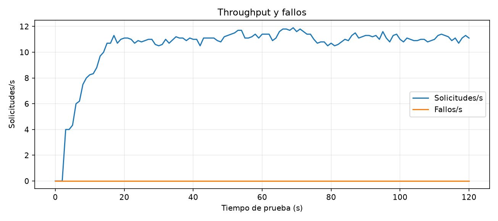
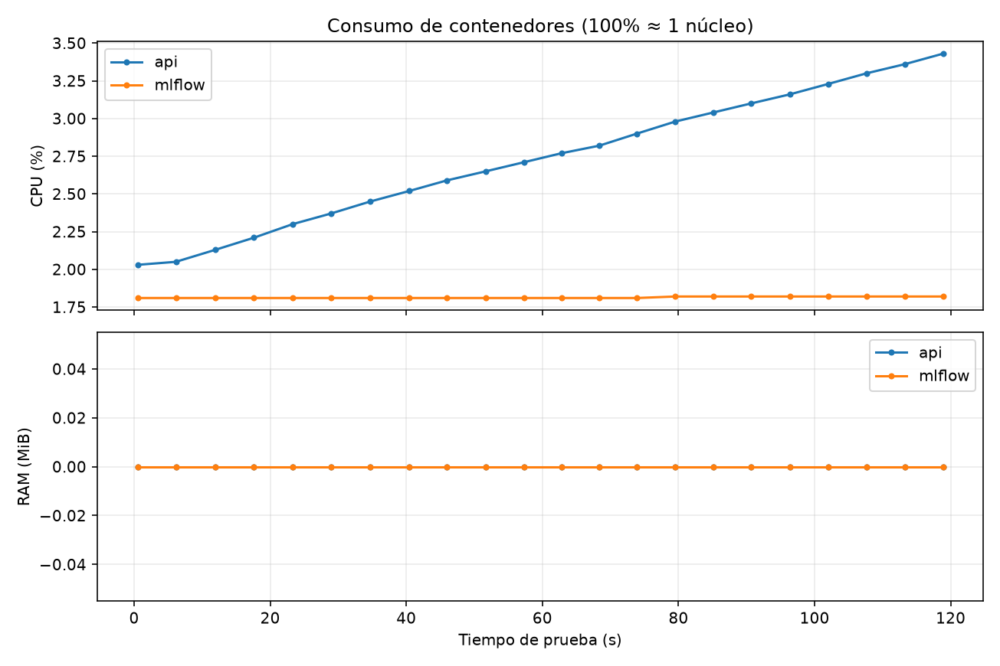
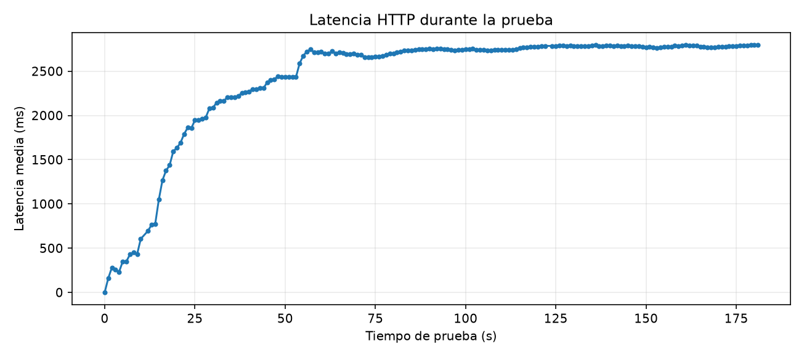
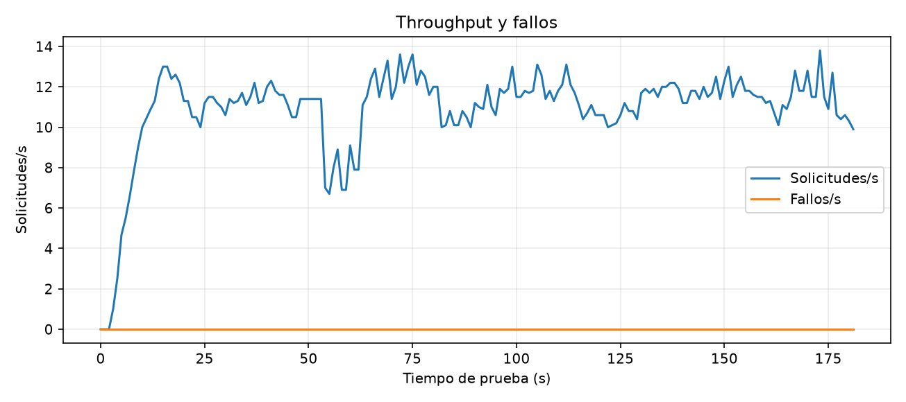
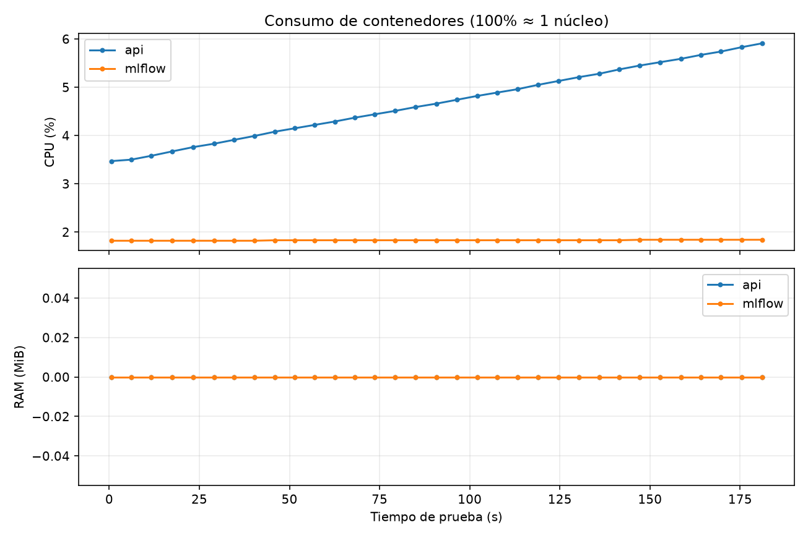

# Entregable 7 — Comparativo real de pruebas de carga y FinOps

Resultados generados exclusivamente a partir de los archivos `*_resumen.json`
y de las gráficas producidas por Locust y el monitor de recursos. Las cifras
**son mediciones locales**; la tarifa cloud es una hipótesis de costo.

| Métrica | baja5 | media20 | alta50 |
|---|---:|---:|---:|
| Usuarios | 5 | 20 | 50 |
| Duración configurada (s) | 120 | 120 | 180 |
| Predicciones exitosas | 373 | 1,314 | 2,042 |
| RPS exitosos | 3.108 | 10.950 | 11.344 |
| Latencia media (ms) | 81.53 | 297.19 | 2798.05 |
| Latencia p95 (ms) | 550.00 | 960.00 | 4800.00 |
| Latencia p99 (ms) | 610.00 | 1100.00 | 7000.00 |
| Errores (%) | 0.00 | 0.00 | 0.00 |
| CPU API promedio (%) | 1.89 | 2.73 | 4.67 |
| RAM API máxima (MiB) | 0.00 | 0.00 | 0.00 |
| USD / inferencia exitosa | 0.000007462 | 0.000002118 | 0.000002045 |
| USD / 1000 inferencias | 0.007462 | 0.002118 | 0.002045 |

## Evidencias gráficas

### baja5 (5 usuarios)

[Reporte HTML Locust](baja5_locust.html) · [Detalle FinOps](baja5_resumen.md)

### media20 (20 usuarios)

[Reporte HTML Locust](media20_locust.html) · [Detalle FinOps](media20_resumen.md)

### alta50 (50 usuarios)

[Reporte HTML Locust](alta50_locust.html) · [Detalle FinOps](alta50_resumen.md)

## Discusión y limitaciones (completar con interpretación del equipo)

- **Desempeño:** describir tendencias en p95/p99, RPS y errores por concurrencia.
- **Recursos:** explicar relación de CPU y RAM con variaciones de latencia.
- **FinOps:** comparar USD/inferencia de los escenarios; distinguir costo marginal,
  utilización y costo de inactividad. El supuesto representa una VM completa
  para API + MLflow, pero excluye red, almacenamiento y costo del generador Locust.
- **Validez externa:** resultados en Podman/WSL2 no acreditan igual throughput
  en AWS; confirmar tarifa y tamaño antes de tomar decisiones de producción.

## Evidencia GitHub (completar manualmente)

- URL del repositorio: PENDIENTE
- URL de ejecución GitHub Actions con todos los jobs en verde: PENDIENTE
