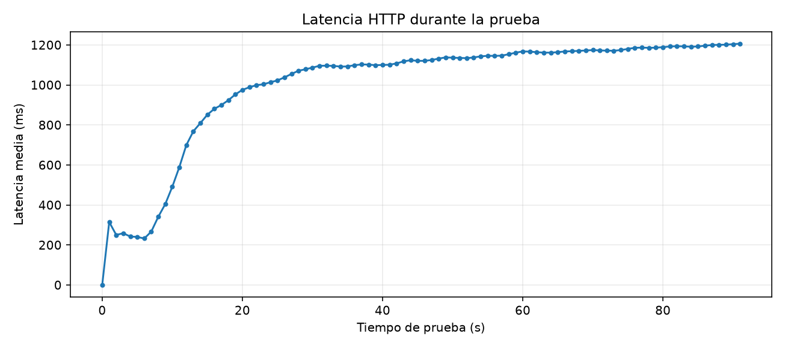
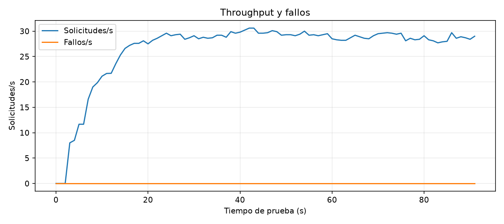
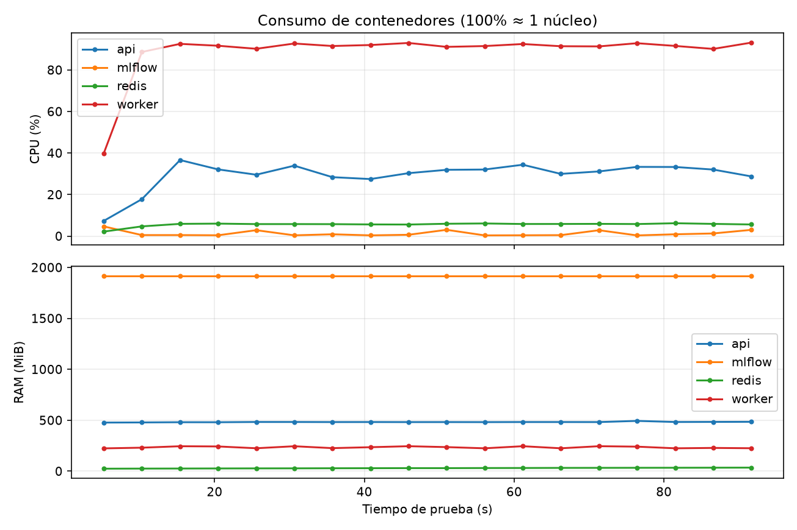

# Entregable 7 — Resultados reales: async_u80

**Ambiente:** motor podman; 80 usuarios, 90 s configurados; tres modelos desde snapshots.

## Desempeño de las inferencias

| Indicador | Medición |
|---|---:|
| Peticiones totales | 2,564 |
| Inferencias satisfactorias (HTTP 200 + JSON esperado) | 2,564 |
| Fallos | 0 (0.00%) |
| Throughput medio exitoso | 28.49 pred/s |
| Latencia promedio | 1206.6 ms |
| Latencia p50 | 1200.0 ms |
| Latencia p95 | 1600.0 ms |
| Latencia p99 | 1700.0 ms |

### Desglose por endpoint

| Modelo | Peticiones | Errores | p95 (ms) |
|---|---:|---:|---:|
| ASYNC /v1/jobs/predict/p2 | 2564 | 0 | 1600.0 |

## Recursos de contenedores

| Servicio | CPU promedio | Memoria máxima |
|---|---:|---:|
| api | 29.5% | 493.5 MiB |
| mlflow | 1.3% | 1916.9 MiB |
| redis | 5.6% | 35.0 MiB |
| worker | 88.7% | 245.2 MiB |

## FinOps (simulación de infraestructura; throughput medido localmente)

**Referencia:** [EC2 t3.large, Linux, us-east-1](https://aws.amazon.com/ec2/instance-types/t3/), USD 0.0835/h.
**Costo hipotético de 90 s:** USD 0.002087.
**Costo unitario estimado:** USD 0.00000081 por inferencia exitosa.
**Costo por 1,000 inferencias exitosas:** USD 0.000814.
**Escenario VM encendida 720 h/mes:** USD 60.12/mes (sin extras).

### Limitaciones del cálculo

- Proyección teórica para una única instancia: no es una factura real de AWS.
- Asume tasa constante durante toda la ventana configurada; incluye ramp-up y puede subestimar capacidad estable.
- El precio de la VM se asigna por completo a API + MLflow. No incluye impuestos, discos, tráfico, red, backups ni Supabase.
- La tasa medida en la laptop/Podman no garantiza el rendimiento de EC2 t3.large.
- T3 usa créditos de CPU: un uso sostenido por encima del baseline puede generar cargos adicionales.
- Las mediciones del proceso Locust se ejecutan fuera de la VM hipotética: su costo no se incluye.

### Ideas de optimización para validar

- Repetir las pruebas con 5, 20 y 50 usuarios y comparar p95, errores, RPS y costo unitario.
- Evaluar separar MLflow del host de inferencia y dimensionar CPU/RAM según picos reales.
- Con picos intermitentes, comparar autoscaling / horarios de apagado contra una VM 24/7.
- Si CPU está saturada, comparar otra familia de instancias no burstable o más réplicas.
- Cachear únicamente consultas deterministas y repetidas si la latencia y coherencia lo permiten.

## Gráficas de las mediciones

**Metodología:** Locust envía solicitudes HTTP con ejemplos P1/P2/P3 (50%/30%/20%).
Los archivos `*_locust*.csv` contienen las métricas capturadas por Locust y
`*_recursos.csv` contiene las muestras periódicas de `docker stats`/`podman stats`.
Las estimaciones no deben presentarse como gasto real ni como benchmark ejecutado en AWS.
