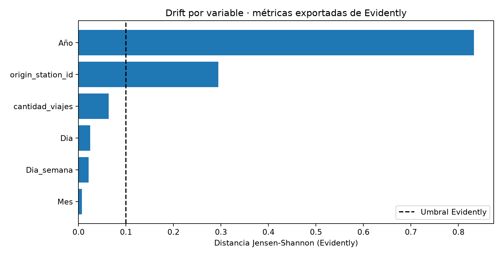
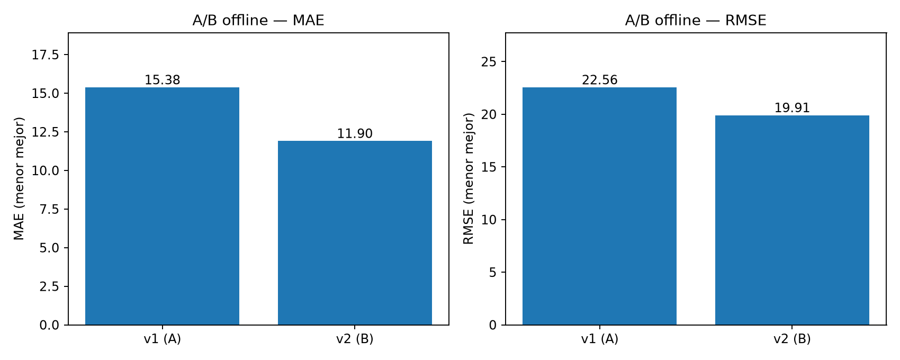
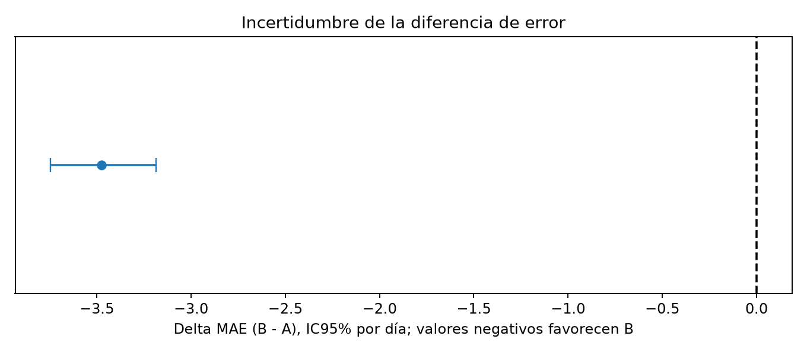

# Entregable 8 — Drift, calidad y comparación A/B (MiBici, P1)

**Equipo 19 · Operaciones de aprendizaje automático**  
**Estado:** reporte generado automáticamente con los Parquet locales y el Registry real de MLflow.

## 1. Objetivo y diseño

Se supervisa **P1: demanda diaria de viajes por estación**, utilizando la misma definición de variables del entrenamiento original. El baseline es la versión **v1** del modelo `mibici-equipo19-p1-demanda`. El candidato es la versión **v2** del mismo modelo registrado.

- **Referencia:** 2024_07, 2024_08, 2024_09; datos comprendidos en el entrenamiento histórico (enero 2024 a junio 2025).
- **Actual:** 2026_07, 2026_08, 2026_09; datos posteriores de MiBici, mismos meses del calendario para mitigar estacionalidad.
- **Reentrenamiento alternativo:** entrenamiento histórico y julio–agosto de 2026. No utiliza septiembre de 2026.
- **Holdout A/B:** septiembre de 2026. Ambos modelos predicen las mismas 13,974 filas estación/día sin ajustar hiperparámetros con este mes.

**Limitaciones del diseño:** Es un A/B *offline, retrospectivo y pareado*, no un experimento online aleatorizado. El P1 histórico agrupa solo estaciones/días con viajes registrados; los días con cero viajes no aparecen, lo que limita su representatividad. La estación se codifica con OneHotEncoder(handle_unknown='ignore') y estaciones nuevas pueden perder información. No se asume que drift estadístico implica degradación.

## 2. Reporte de Evidently y calidad

Evidently **0.7.23** ejecuta `DataDriftPreset` y `DataSummaryPreset` con **Jensen–Shannon, umbral 0.10**, y calcula métricas por variable y tests de calidad. Se analizaron **33,032** filas de referencia y **41,611** actuales; para el análisis de distribuciones se muestrearon **10,000** y **10,000** respectivamente, con semilla 42.

**Resultado agregado Evidently:** 2 variables con drift; proporción **33.3%** (drift de conjunto: **No** según umbral 50%). El cambio de `Año` es inevitable y se reporta como variable de contexto, no como señal de reentrenamiento por sí sola. Variables alteradas distintas de `Año`: **origin_station_id**.

| Variable | Score JS | Drift | Interpretación / posible impacto |
|---|---:|:---:|---|
| Año | 0.8326 | Sí | Cambio esperado por diseño entre 2024 y 2026; por sí solo NO evidencia degradación. |
| origin_station_id | 0.2943 | Sí | Variación del uso y composición de estaciones; vigilar estaciones no vistas. |
| cantidad_viajes | 0.0633 | No | Cambio de la distribución de la demanda observada (target), no prueba causal de error. |
| Dia | 0.0244 | No | Cambios en días del mes representados y en la mezcla de fechas con viajes. |
| Dia_semana | 0.0210 | No | Cambios en patrones de días laborales y fines de semana. |
| Mes | 0.0074 | No | Puede indicar variación de estacionalidad, incluso comparando julio–septiembre. |

**Calidad:** porcentaje máximo de nulos por variable: referencia **0.00%**, actual **0.00%**. Consultar `calidad_datos.csv` para cada columna, cardinalidad y duplicados. **Gráficas interactivas originales de Evidently y tablas de calidad:** `evidently_drift_calidad.html`. Los valores y la gráfica anterior derivan de `evidently_snapshot.json`, exportación de Evidently (no son métricas estimadas externamente). Para la entrega final se pueden incorporar capturas de las distribuciones del HTML, especialmente de estaciones y demanda.

## 3. Comparación A/B: P1 v1 vs v2

| Métrica en septiembre 2026 | A: champion v1 | B: candidato v2 | Interpretación |
|---|---:|---:|---|
| MAE ↓ | 15.3792 | 11.9050 | Menor es mejor |
| RMSE ↓ | 22.5561 | 19.9095 | Penaliza errores grandes |
| R² ↑ | 0.6790 | 0.7499 | Mayor es mejor |

El cambio relativo de MAE del candidato frente al champion es **22.59%** (positivo significa mejora). Se aplicó bootstrap **pareado por día** con 2,000 réplicas y semilla 42; ΔMAE (B−A) = **-3.4742**, IC del 95% **[-3.7461, -3.1860]** sobre 30 días. El criterio predefinido para recomendar B exige reducción de MAE ≥ 2%, límite superior del IC95% < 0 y RMSE no peor.

## 4. Recomendación y Continuous Training

**Decisión técnica:** **promover candidato**. La evidencia favorece promover al candidato, tras validar condiciones operativas (latencia, integridad y aprobación humana). El alias champion no cambió durante el A/B.

Como política de **Continuous Training**, conviene ejecutar esta comparación mensualmente: monitorear deriva y nulos en cada nueva carga de datos; investigar anomalías de estación/demanda; si existen cambios accionables persistentes y/o degradación de MAE, reentrenar usando solo periodos ya cerrados; evaluar el nuevo candidato en un holdout posterior e independiente antes de aprobar una promoción. Monitorear también latencia, errores y cobertura en la API. El reporte **no demuestra** que un cambio distributivo sea la causa de un error.

## 5. Evidencias y reproducibilidad

- `evidently_drift_calidad.html`: panel interactivo original de Evidently (distribuciones y calidad).
- `evidently_snapshot.json`, `drift_por_variable.csv`, `resumen_drift.json`, `calidad_datos.csv`: trazabilidad estadística.
- `entrenamiento_candidato.json`, `registro_candidato.json`: meses, hashes y versión registrada en MLflow.
- `predicciones_ab.csv`, `metricas_ab.csv`, `resultado_ab.json`: evidencia sobre las mismas observaciones y procedimiento bootstrap; corrida MLflow A/B: **09cb66f30f6e4e4da6adefb3a1694e41**.
- `drift_por_variable.png`, `comparacion_ab.png`, `bootstrap_ab.png`: figuras de esta síntesis.

## 6. Referencias

- Evidently AI. (2026). *Data and ML checks*. https://docs.evidentlyai.com/quickstart_ml
- Evidently AI. (2026). *Data Drift*. https://docs.evidentlyai.com/metrics/preset_data_drift
- MLflow. (2026). *Model Registry*. https://mlflow.org/docs/latest/ml/model-registry
- MiBici. *Datos abiertos*. https://mibici.net/es/datos-abiertos/
- Huyen, C. (2022). *Designing Machine Learning Systems*. O'Reilly Media.
- Treveil, M., et al. (2020). *Introducing MLOps*. O'Reilly Media.
